<div align="center">



# Neon Rift

**A one-file neon arcade game. No build step, no dependencies.**


</div>

## Play

Open `index.html` in any modern browser. Or host it for free with GitHub Pages: **Settings → Pages → Deploy from branch → `main` / root**.

## How to play

| Input | Action |
|---|---|
| Mouse / touch drag | Steer the ship |
| `←` `→` or `A` `D` | Steer with keyboard |

- Collect **cyan shards** to build a combo (up to ×10).
- Dodge **pink blocks**. One hit ends the run.
- Missing a shard resets your combo. Speed rises the longer you survive.
- Best score is saved in your browser.

## Project layout

```
neon-rift/
├── index.html        # the entire game (HTML + CSS + JS)
├── assets/banner.svg # animated README banner
├── docs/
│   ├── DESIGN.md     # UI/UX decisions and tokens
│   └── SKILLS.md     # AI-assisted workflow notes
├── LICENSE
└── README.md
```

## Tweak it

Constants live at the top of the script in `index.html`: ship size (`r`), starting speed (`sp`), spawn rate and acceleration (`step()`). Colors are CSS variables in `:root`.

## Roadmap

- [ ] Sound effects (WebAudio)
- [ ] Power-ups (shield, slow-mo)
- [ ] Online leaderboard

## License

MIT, see [LICENSE](LICENSE).
